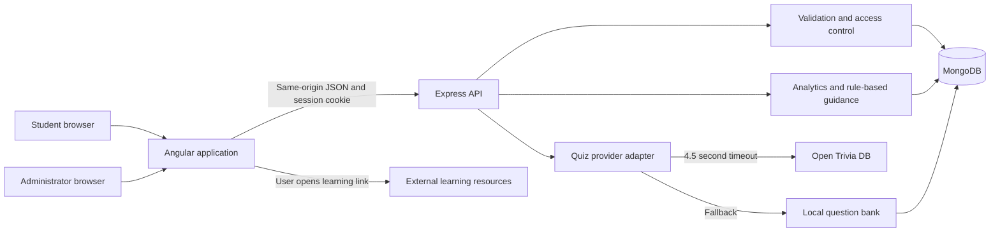
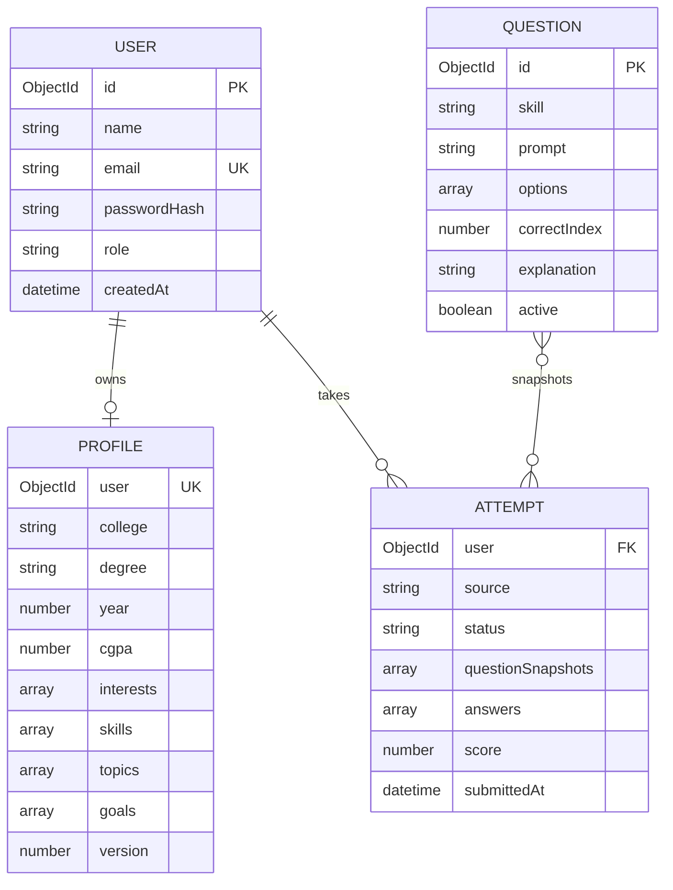
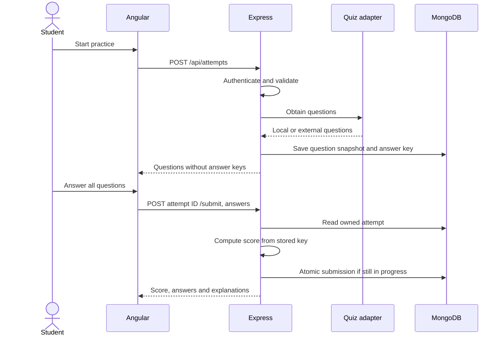

# Architecture and design

## Technology choices

| Layer | Implementation |
| --- | --- |
| Client | Angular 20.3, TypeScript 5.9, standalone components, lazy routes, zoneless change detection |
| API | Node.js 24 LTS, Express 5, JSON REST endpoints |
| Data | MongoDB, Mongoose 8 schemas and indexes |
| Authentication | bcrypt password hashing, signed 8-hour JWT in an HTTP-only cookie |
| Validation | Zod schemas, strict request fields, bounds and identifier checks |
| Verification | Node test runner, Supertest, real isolated MongoDB, Playwright |

The application uses a single origin. Express serves the compiled Angular files and the API in a packaged run. During development Angular proxies API traffic to Express. No JWT is stored in browser local storage.

## Persistent data model

The question-to-attempt edge is conceptual: an attempt embeds a full snapshot rather than a live foreign-key reference. Editing a question cannot change an existing attempt. Profiles embed bounded skills, topics, and goals so one atomic document update saves all related profile changes. Emails and profile owners have unique indexes. Attempts have an index on `(user, createdAt)` for history retrieval.

Profile updates use an explicit version check and atomic increment. The API returns 409 if the submitted version is stale. Test submission atomically changes `in-progress` to `submitted`; racing submissions cannot score the same attempt twice.

## Mock-test sequence

## Separation of responsibilities

- `client/src/app/api.ts`: same-origin requests, session state, typed profile structures, loading/error state.
- Page components: forms, lists, navigation, presentation. No client-provided score or role is trusted.
- `server/src/app.js`: HTTP routing and authorization. Student routes always derive ownership from the verified session, never a client-supplied user ID.
- `validation.js`: strict request contracts. Bounded text, array sizes, scores, dates, and numerical fields.
- `models.js`: database structure and indexes.
- `guidance.js`: pure calculations, independently testable with profile and result inputs.
- `quiz-provider.js`: provider timeout, response checks, URL decoding, attribution, and fallback.
- `catalog.js`: illustrative career paths, skill targets, external resource links, original sample question bank.

## Access and security decisions

JWTs have a fixed issuer, audience, allowed signing algorithm, and an eight-hour expiry. Every request loads the current user from MongoDB and checks their current role. Public registration cannot create or promote administrators. Hashes are excluded from normal database selections and API responses.

State-changing API requests require `X-Requested-With: PathPilot`. The server grants no CORS permissions, rejects requests marked cross-site, and uses SameSite=Strict cookies. Helmet sends content-security and other HTTP headers. Angular uses text interpolation for provider content. Critical-CSS inlining is disabled to avoid generated inline event handlers conflicting with the CSP.

Logout removes the browser cookie; there is no server-side JWT revocation list. A previously stolen token would remain valid until its expiry. Rate limits are in-process and appropriate for one lab server; a multi-instance deployment would need a shared rate-limit store. The project contains no password-recovery or email-verification service.

## Assumptions and limits

- Administrator-level functions are not enumerated in detail by the SRS. This implementation chooses activity counts, a basic student directory, and question-bank management.
- Five example careers and fifteen canonical skills are included. They can be extended in the catalog and corresponding validation/tests.
- Learning progress is self-reported. Tests are untimed practice, with no proctoring or question randomization guarantees beyond a shuffled local selection.
- Recent attempt lists return up to 200 records; admin lists return up to 200 students / 500 questions. Analytics currently process all a student's submitted attempts, so larger datasets need pagination, incremental aggregation, and additional capacity testing.
- External integration is Open Trivia DB for computer trivia plus curated links for learning/career resources. No commercial career API credentials are required.
- Persistent MongoDB storage, or the Docker named volume, preserves data across normal restarts. Backups and disaster recovery are an operator responsibility.
