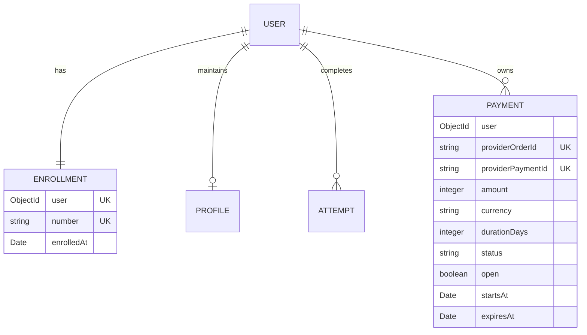
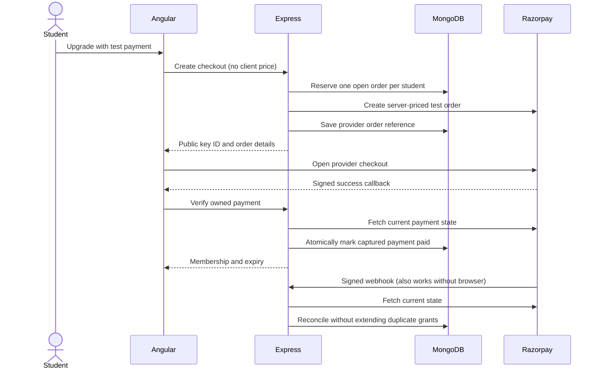

# Premium and enrollment design

## Lab change request

CR-01: integrate a payment gateway for a premium plan.

CR-02: maintain a persistent database register of enrolled students.

The original SRS remains the baseline. These are teacher-requested extensions. Provisional product decisions: registration means enrollment; a one-time INR 499 test purchase grants 30 days of Premium; the new four-week roadmap and progress report are premium benefits; existing career guidance remains Basic. Currency, price and term were not confirmed by the user when this revision was prepared.

## Data relationships

Each student receives one enrollment, using a deterministic ID derived from their existing user ID. Academic details remain in the profile to avoid divergent copies. Membership is derived from verified, paid records with a future expiry date. This avoids maintaining a second potentially inconsistent membership flag on the user or enrollment.

## Payment flow

Only captured payments unlock access. HMAC validation does not by itself prove capture; the provider lookup is also required. A browser callback, webhook or manual status refresh can finish the same purchase. All converge on one atomic `pending → paid` transition. Duplicate delivery does not add time. Current provider state is fetched for late events; a refunded record is terminal and cannot be restored by an old capture event.

## Acceptance checks

| Requirement | Evidence |
| --- | --- |
| Gateway opens for an authenticated student | Angular checkout integration and callback browser test |
| Price cannot be altered by the student | Strict server request schema; tampered amount test |
| Failed or forged payment grants no access | Signature, captured-status and amount/currency mismatch tests |
| A payment belongs to only one student | Ownership checks for verify and refresh; cross-student tests |
| Premium persists and expires | MongoDB payment dates; refresh/reload and expired-access tests |
| Duplicate notifications are safe | Concurrent callback/webhook and replay tests |
| Existing students gain enrollment records | Idempotent migration test |
| Admin can view students and payments | Authenticated paginated endpoints plus browser search/filter check |
| Student cannot access admin records | Role-denial tests |
| Vercel receives signed original bytes | Express-listener adapter test with whitespace-sensitive webhook signature |

The gateway test double validates application behavior, not real provider account setup. A genuine Razorpay test transaction and public webhook delivery must be verified after configuration. No live billing, recurring charge, tax invoice or refund initiation is included.
